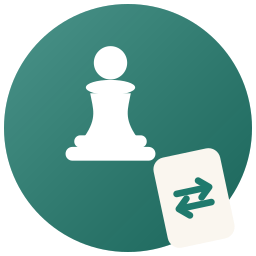

# IsaChess Online



**Play it now: <https://isachess.onrender.com>**

Play **IsaChess** — chess where the cards decide how you move — with a friend (2 players) or with two friends (3 players), each on your own device.
On the opening page you pick **2-player game** or **3-player game**, send the link to the others, and play. No accounts.

### Three-player mode

- The board is a 96-square hexagon shared by three armies: White, Red and Black.
- A player who is checkmated at the start of their turn is eliminated; their pieces stay on the board but cannot move.
- The last player with a king wins.
- Cards that name an opponent let you choose which one.

The design is in `docs/superpowers/specs/2026-10-15-three-player-design.md`.

The house rules are in `docs/superpowers/specs/2026-10-13-isachess-online-design.md`
(the rulebook's rules plus every clarification we agreed on). The build plan is in `docs/superpowers/plans/`.

## How it is built

| Package | What it does |
|---|---|
| `packages/engine` | Pure rules: chess, every card, turn flow, what each player is allowed to see. No network, no UI. |
| `packages/server` | Node + WebSockets. Holds live games in memory and checks every action with the engine; each player is sent only their own hand. |
| `packages/web` | The React website: home page, board, hand, card prompts. |

## Run it on your computer

Needs Node 22.

```bash
npm install
npm test            # engine, server and web unit tests
npm run build
npm start           # http://localhost:3000
```

While developing, run the server and the website with live reload in two terminals:

```bash
npm run dev -w @isachess/server     # http://localhost:3000
npm run dev -w @isachess/web        # http://localhost:5173 (proxies to the server)
```

### End-to-end test

`npm run e2e` builds the app, starts it on port 4173 with a fixed card shuffle (`ISACHESS_SEED`),
and plays a 2-player and a 3-player game between real browser windows. It uses the Chromium already installed at
`/opt/pw-browsers/chromium`; adjust `e2e/playwright.config.ts` if yours lives elsewhere.

## Put it on the internet (Render)

1. Create a free account at <https://render.com> and connect your GitHub account.
2. **New → Blueprint**, pick this repository and the branch you want to publish.
3. Render reads `render.yaml` (which follows the `main` branch and redeploys automatically whenever `main` changes), builds, and gives you your address, which comes from the service name in `render.yaml`. The live game is at <https://isachess.onrender.com>.
4. Open it, click **2-player game** or **3-player game**, and send the game link to your friends.

Notes:
- Free Render services go to sleep when idle and restart when visited. Games are kept in memory only,
  so a restart ends any game in progress. (Spec §1: no persistence in version 1.)
- Games that nobody has touched for 24 hours are removed automatically.

## Credits

Logo: drawn for IsaChess (a pawn and a reverse card).

Chess piece artwork: the "Cburnett" set by Colin M.L. Burnett, from
[Wikimedia Commons](https://commons.wikimedia.org/wiki/Category:SVG_chess_pieces)
(used under the BSD / GPLv2+ / CC BY-SA 3.0 licences it is offered under). Files are in `packages/web/public/pieces/`.

Red pieces: a recolour of the same set.
